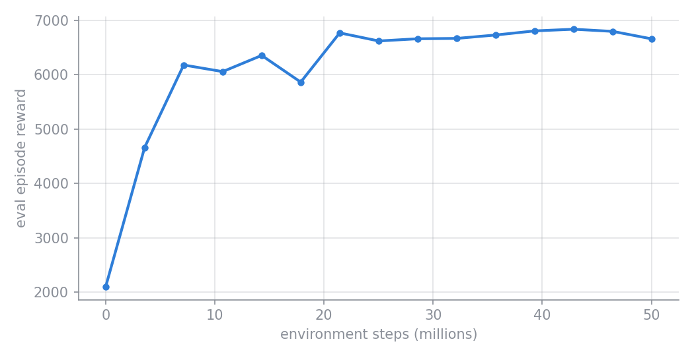

# Training a policy

`example/train.py` trains a PPO policy for the Cheetah, checkpoints it as it goes, and
saves a video of the trained policy at the end. This page walks through the script step
by step, then shows what a finished run looks like on disk.

```bash
python -m example.train --config example/cheetah.yaml             # logs to Weights & Biases
python -m example.train --config example/cheetah.yaml --no_wandb  # no W&B
```

## Command-line options

| Flag | Default | Meaning |
| --- | --- | --- |
| `--config` | *(required)* | Path to the run's YAML config |
| `--no_wandb` | off | Turn off Weights & Biases logging |
| `--wandb_entity` | `njanwani-gatech` | W&B entity (user or team) to log to |
| `--wandb_project` | `my-awesome-project-2` | W&B project to log to |
| `--T` | `10.0` | Seconds of the trained policy to save as a video. `0` skips the video. |
| `--camera` | `track` | Camera to render the video from |

## Step by step

### 1. Pick a rendering backend

```python
import os
os.environ["MUJOCO_GL"] = "egl"
```

MuJoCo reads `MUJOCO_GL` when it is first imported, so it is set before anything else.
`egl` renders on the GPU without a display, which is what you want on a cluster. The
video in step 7 is the only rendering the script does. See
[`setup_gpu`][minimal_mjx.utils.setupGPU.setup_gpu] if you want this picked
automatically per machine.

### 2. Read the config

```python
cfg = mm.utils.Config(config_path)
```

[`Config`][minimal_mjx.utils.config.Config] loads the YAML file and exposes the values
the library needs as properties: `cfg.env_name`, `cfg.env_params`, `cfg.ppo_params`,
`cfg.network_params`, `cfg.run_dir`, and so on. It is the only code that knows the
YAML layout. Every library function takes plain arguments, so you can subclass
`Config` for a different layout or skip it. See [The config file](../guides/configuration.md).

### 3. Build the environment

```python
env, env_params = create_environment(cfg, for_training=True)
```

`create_environment` (in `example/create_environment.py`) maps `cfg.env_name` to an
environment class, here `Cheetah`. `for_training=True` forces the `jnp` (JAX/MJX)
backend whatever the config says, because Brax trains thousands of environments in
parallel on the accelerator and needs every step to be traceable by JAX.

### 4. Create the run directory and save the config

```python
run_dir = mm.create_training_directory(cfg.run_dir, overwrite=cfg.is_test)
cfg.save(run_dir / 'config.yaml', make_dir=False)
```

[`create_training_directory`][minimal_mjx.learning.training.create_training_directory]
creates `save_dir/name` (here `example/results/cheetah/test`). It refuses to reuse a
directory that already holds training output, unless `overwrite` is set. Runs named
`test` set it, so you can rerun a scratch config freely; any other name protects its
earlier results.

[`Config.save`][minimal_mjx.utils.config.Config.save] then writes the config next to
the checkpoints. For runs not named `test` it also records the current git commit as
`git_hash`, and asks you to confirm if the working tree has uncommitted changes. That
saved `config.yaml` is what you later pass to `rollout.py` to reproduce this run.

### 5. Start a Weights & Biases run (optional)

```python
run = mm.initialize_wandb(
    name    = str(run_dir).replace('/', ''),
    entity  = wandb_entity,
    project = wandb_project,
    config  = cfg.cfg.to_dict()
)
```

[`initialize_wandb`][minimal_mjx.utils.logging.initialize_wandb] wraps `wandb.init`
and logs the whole config, nested as in the YAML file. With `--no_wandb`, `run` is
`None` and every later step skips its W&B logging.

### 6. Train

```python
make_inference_fn, params, _ = mm.train(
    env            = env,
    eval_env       = env,
    run_dir        = run_dir,
    handle_params  = mm.setup_ppo,
    ppo_params     = cfg.ppo_params,
    network_params = cfg.network_params,
    run            = run,
    overwrite      = cfg.is_test,
)
```

[`train`][minimal_mjx.learning.training.train] does the heavy lifting:

1. **Prepares the run directory** and records the W&B run id in `wandb_run_id.txt`,
   so a later job can continue the same W&B run.
2. **Builds the trainer** by calling `handle_params(ppo_params, network_params, resumed)`.
   [`setup_ppo`][minimal_mjx.learning.training.setup_ppo] returns Brax's PPO trainer with
   your `ppo_params` bound, and a factory for the policy and value networks built from
   `network_params`. To use another algorithm, pass your own handler with the same
   signature.
3. **Attaches two callbacks** that Brax calls after every evaluation (`num_evals` times
   over the run):
    - a **progress callback**, by default
      [`plot_progress`][minimal_mjx.utils.plotting.plot_progress], which appends the
      evaluation reward to `progress.csv`, logs every scalar metric to W&B, and stops
      training if the reward becomes NaN;
    - a **checkpoint callback**, which writes the policy parameters with
      [`save_model`][minimal_mjx.utils.logging.save_model] into a directory named after
      the step count (and uploads it as a W&B artifact).
4. **Runs Brax PPO**, wrapping the environment with MuJoCo Playground's
   `wrap_for_brax_training`, then prints the time spent compiling and the time spent
   training.

It returns `make_inference_fn`, the trained `params`, and Brax's final metrics.

!!! tip "Continuing a run"
    `mm.train(..., resume=True)` continues from the newest checkpoint in `run_dir`
    instead of refusing to touch it. `num_timesteps` is then the run's total budget,
    and training covers only the steps still owed. To train longer, raise
    `num_timesteps` in the saved config and resume.

### 7. Save a video of the trained policy

```python
inference_fn = jax.jit(make_inference_fn(params, deterministic=True))
frames, *_ = mm.rollout_policy(
    inference_fn = inference_fn,
    env          = env,
    n_steps      = int(T / env.dt),
    camera       = camera,
    width        = 640,
    height       = 480
)
video_path = run_dir / 'rollout.mp4'
mm.save_video(frames, env.dt, video_path)
if run is not None:
    run.log({'rollout': wandb.Video(str(video_path), format='mp4')})
```

`make_inference_fn(params, deterministic=True)` builds a policy that always takes the
mean action rather than sampling. [`rollout_policy`][minimal_mjx.eval.rollout.rollout_policy]
runs it for `T` seconds and renders the frames, and
[`save_video`][minimal_mjx.utils.plotting.save_video] writes them to
`run_dir/rollout.mp4` at the control rate. The video is also logged to W&B.

This uses the training environment (`jnp` backend) rather than building a separate
`np` one. [Rolling out a policy](rollout.md) shows the more flexible way to evaluate a
checkpoint after training.

## What a finished run looks like

The example run in `example/results/cheetah/test` trained for 50M environment steps
with 128 parallel environments and 15 evaluations:

```text
example/results/cheetah/test/
├── config.yaml          # the config this run used (pass it to rollout.py)
├── progress.csv         # one row per evaluation: time, step, reward, reward std
├── rollout.mp4          # step 7's video of the final policy
├── wandb_run_id.txt     # the W&B run this directory belongs to
├── 000000000000/        # one checkpoint per evaluation, named by env step
├── 000003573760/
├── ...
└── 000050032640/        # newest checkpoint; rollout.py loads this one by default
    ├── ppo_network_config.json
    └── ...              # Orbax checkpoint files
```

Checkpoints land every 3,573,760 steps: Brax rounds the evaluation interval up to a
whole number of training iterations (`batch_size × unroll_length × num_minibatches` =
2,560 environment steps here), which is also why the last one sits slightly past 50M. Each checkpoint
directory holds everything needed to rebuild the policy, including its
`ppo_network_config.json` (observation and action sizes, layer sizes, activation).

`progress.csv` gives the learning curve. Brax evaluates once before training starts,
so the first row is the untrained policy. In this run the gap between the first two
evaluations was about 70 seconds, mostly JAX compiling the training step (`train`
prints it as `time to jit`). After that, evaluations came every 31 seconds or so, and
the run took about 8 minutes in all:



And `rollout.mp4` shows the final policy:

<figure markdown="span">
  <video src="../../assets/cheetah-rollout.mp4" poster="../../assets/cheetah-rollout-poster.jpg"
         width="360" autoplay loop muted playsinline controls></video>
</figure>

## Full script

??? example "example/train.py"

    ```python
    --8<-- "example/train.py"
    ```
